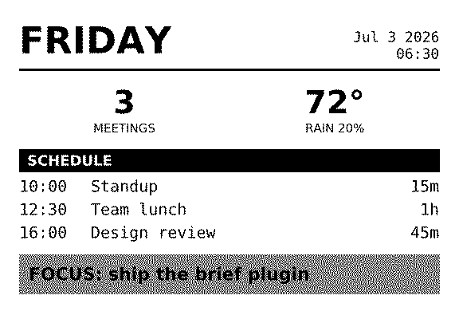
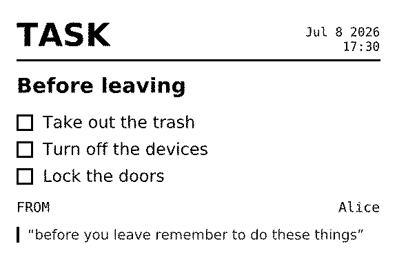
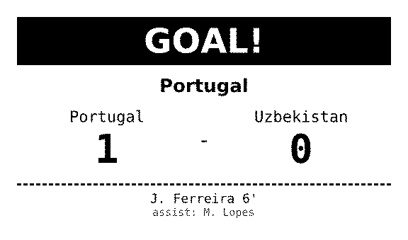

# docket

A thermal-receipt platform for an 80mm (576-dot) ESC/POS printer. A hosted
server renders Liquid + HTML templates into printer bytes. An ESP32
appliance polls for jobs and prints them over serial. Plugins print on
their own: on a schedule (live World Cup goals, a daily morning brief) or
when a message arrives (texts forwarded from a phone, turned into task
slips by Gemini). A multi-user dashboard manages it all. Accounts are
invite-only, and each account has its own templates, plugins, history and
printers.

<table>
  <tr>
    <td valign="top"></td>
    <td valign="top"></td>
    <td valign="top"></td>
  </tr>
  <tr>
    <td valign="top">Daily Brief. The morning-brief plugin prints it at a set time each morning.</td>
    <td valign="top">Task. The message-ingest plugin prints it from a forwarded text.</td>
    <td valign="top">WC Goal. The espn-worldcup plugin prints it when a team scores.</td>
  </tr>
</table>

Each image is the renderer's 1-bit output for sample data, the same image
the printer receives.

Templates render entirely in Node, with no headless browser:

**Liquid template + data -> HTML -> Satori (flexbox layout) -> SVG -> resvg
(PNG) -> Floyd-Steinberg dither -> ESC/POS raster bytes**

Text receipts print as one `GS v 0` raster. Dithered images print as
memorize-then-print chunks (`GS *` / `GS /`), rotated 180° with a flush cut
(`render/render-core.js`, `docs/rp850-field-notes.md`).

## Status

Everything in this README is built and runs on one hosted instance with
one printer: a Rongta RP850 on 80mm paper, driven by an ESP32 DevKit
(WROOM-32) through a MAX3232 serial adapter at 115200 baud.
[docs/rp850-field-notes.md](docs/rp850-field-notes.md) has that printer's
measured behavior. One person maintains the project, and the hosted
instance is invite-only. To run your own, see [Deploy](#deploy).

One printer fits inside the free plans of Vercel (Hobby), Upstash and Neon:

| Meter | One printer, per 30 days | Free allowance |
|---|---|---|
| Vercel function invocations (`/next` and `/tick` polls) | 604,800 | 1,000,000 |
| Vercel CDN Requests (measured, whole instance) | 929,361 | 1,000,000 |
| Upstash Redis commands (idle, one account) | about 112,000 | 500,000 |
| Vercel Blob writes | 2 or 3 per print | 2,000 |

The World Cup plugin adds up to about 300,000 Redis commands a month while
it is on. On Hobby, an allowance that runs out is not billed: the feature
stops until 30 days have passed. The numbers and their sources are in
[docs/store-costs.md](docs/store-costs.md).

## What you need

- Node 22.12 or later.
- Optionally, an 80mm ESC/POS thermal printer.
  - A serial printer, like the Rongta RP850 this build uses, needs an
    ESP32 board and a MAX3232 serial adapter.
    [docs/receipt-printer-build-guide.md](docs/receipt-printer-build-guide.md)
    has the parts list and the bring-up steps.
  - A network printer that accepts jobs on TCP port 9100 can use the
    laptop printer agent (`agent/printer-agent.js`) instead.
- You do not need a printer to develop. Set `PRINTER_IP=file:data/prints`
  and the laptop agent writes each job's bytes to `data/prints/` and marks
  the job done (see [CONTRIBUTING.md](CONTRIBUTING.md)).
- To host it: Vercel (with Vercel Blob), Upstash Redis and Neon. Local
  development needs no cloud account.

## Install

`.nvmrc` pins Node 22. `nvm use` picks the newest 22 you have installed,
which must be 22.12 or later (vite, the test runner's bundler, needs it).

```
npm install
```

The DejaVu fonts the renderer uses are vendored in `render/fonts/`, so no
system font install is needed. `FONT_DIR` points the renderer elsewhere.

`CONTRIBUTING.md` has the local setup: an account, the dev server, and the
checks.

## Configuration

Copy the example env file and fill in what you need:

```
cp .env.example .env
```

`.env.example` lists every variable the code reads. The main ones:

| Variable | Default | Description |
|---|---|---|
| `STORE_DRIVER` | `json` | Hot-path stores: `json` (local files, the queue in PGlite) or `redis` (Upstash Redis + Vercel Blob) |
| `DATABASE_URL` | *(unset = PGlite)* | Postgres connection (Neon). Unset, local dev uses PGlite, an embedded Postgres |
| `DATA_DIR` | `data/` | Local state: json-driver files, local artifacts, PGlite |
| `PGLITE_DIR` | `DATA_DIR/pg` | Where PGlite keeps its files |
| `BETTER_AUTH_SECRET` | *(falls back to `SESSION_SECRET`, then Better Auth's own `AUTH_SECRET` or `BETTER_AUTH_SECRETS`; with none set locally, generated once in `DATA_DIR/auth-secret`)* | Signs account session cookies. Set it in production, where it has no default |
| `BETTER_AUTH_URL` | *(unset = inferred per request)* | Canonical origin in production |
| `JOB_CAP` | `50` | Job records kept per owner. Past it, the oldest done and failed jobs are trimmed |
| `LEASE_SECONDS` | `120` | Redis driver: seconds before an unacked job returns to the queue |
| `DEVICE_TOKEN` | `dev-token` locally | Lets the laptop agents into the device endpoints. No default on Vercel or in a production build |
| `OWNER_ID` | `default` | The account `DEVICE_TOKEN` resolves to. Set it to your local account id |
| `PRINT_SERVER` | `http://localhost:$PORT` (agents), `http://localhost:3000` (calibration) | Server URL for the laptop agents and `scripts/print-calibration.js` (`PORT` defaults to 3000; the script's first argument overrides it) |
| `HEARTBEAT_SECONDS` | `30` | Seconds between `/tick` POSTs from `agent/heartbeat.js` |
| `POLL_INTERVAL` | `3000` | Laptop printer agent: milliseconds between `/next` polls |
| `PRINTER_IP` / `PRINTER_PORT` | *(none; unset, the agent exits)* / `9100` | Laptop printer agent only: a network printer's address, or `file:<dir>` to write each job to `<dir>/<job id>.bin` with no printer |
| `PRINT_WIDTH` | `576` | Dots per line (576 for 80mm, 384 for 58mm) |
| `FONT_DIR` | `render/fonts` | Directory with the DejaVu TTFs |
| `GEMINI_API_KEY` | *(unset)* | Google AI Studio key for message classification. Without it a message fails, except one starting with `task:` |
| `GEMINI_MODEL` | `gemini-3.1-flash-lite` | Model used when the message-ingest plugin's own `gemini model` setting is blank |
| `WATCH_TEAMS` | *(empty = all)* | Seeds the World Cup plugin's `watchTeams` config when an account first registers it |
| `UPSTASH_REDIS_REST_URL` / `UPSTASH_REDIS_REST_TOKEN` | | Redis driver connection. The `KV_REST_API_*` names the Vercel Marketplace sets also work |
| `BLOB_READ_WRITE_TOKEN` | | Redis driver: Vercel Blob for artifacts and flags. Set automatically on Vercel |
| `DOCKET_EMAIL` / `DOCKET_PASSWORD` | | Sign-in for `scripts/print-calibration.js` |

All settings fall back to the defaults above when unset (`config.js`).
Only the laptop agents (`agent/*.js`) and scripts read `PRINT_SERVER`,
`HEARTBEAT_SECONDS`, `POLL_INTERVAL`, `PRINTER_IP` / `PRINTER_PORT` and
`DOCKET_EMAIL` / `DOCKET_PASSWORD`; the server ignores them.
`.env` is loaded by every script that imports `config.js`. If your `.env`
points `DATABASE_URL` at a production database, prefix local commands with
`DATABASE_URL=` (an empty value wins over `.env`).

## Deploy

The hosted app runs on Vercel. A first deploy:

1. Fork this repository and import the fork into Vercel as a new project.
   In the project's settings, set Node.js Version to 22.x. package.json
   names no Node version, so this setting decides it.
2. In the project's Storage tab, add Upstash Redis, Vercel Blob and a Neon
   database. Create the Blob store with public access: the code writes
   every object as public and builds public URLs, so a private store does
   not work. Connect each store to the Production environment only. Then
   check that the Production variables (Settings, Environment Variables)
   include:
   - `DATABASE_URL`, the Neon connection string.
   - `BLOB_READ_WRITE_TOKEN`.
   - `KV_REST_API_URL` and `KV_REST_API_TOKEN`, or
     `UPSTASH_REDIS_REST_URL` and `UPSTASH_REDIS_REST_TOKEN` from the
     Upstash console.
3. Add these Production variables:
   - `STORE_DRIVER=redis`.
   - `BETTER_AUTH_SECRET`, set to the output of `openssl rand -base64 32`.
   - `BETTER_AUTH_URL`, set to the site's origin, for example
     `https://your-app.vercel.app`.
   - `GEMINI_API_KEY`, only if you use message ingestion.
4. Redeploy, so the deployment picks up the variables.
5. In a clone of your fork, run `npm install`. Then create the schema and
   the first admin account in the Neon database. Copy the connection
   string from the project's `DATABASE_URL`:

   ```
   DATABASE_URL="<neon connection string>" npm run db:migrate
   DATABASE_URL="<neon connection string>" node scripts/create-user.js "Your Name" you@example.com
   ```

   `create-user.js` prompts for the password. Sign in on the site with
   that email and password.
6. In `firmware/docket-agent/`, copy `secrets.h.example` to `secrets.h`.
   Set your Wi-Fi name and password, set `SECRET_SERVER_URL` to the site's
   origin with no trailing slash, and leave `SECRET_DEVICE_TOKEN` empty.
   Flash the ESP32 as Stage 4 of
   [docs/receipt-printer-build-guide.md](docs/receipt-printer-build-guide.md)
   describes.
7. The printer prints a pairing code. Enter it on the Printer page.

Do not connect the stores or set these variables for the Preview
environment. A preview deployment runs the code of a branch or pull
request, and with production stores that code can read and change your
production data. Give Preview its own stores, or none.

After the first deploy, a push to `main` deploys. Before you deploy code
that reads new columns, run `npm run db:migrate` with `DATABASE_URL`
pointing at Neon. The stores select whole rows, so code ahead of the
schema fails every query on that table.

Vercel sets `VERCEL_GIT_COMMIT_SHA`. Its short hash is part of the slip
preview images' cache key, so a deploy that changes rendering refreshes
them.

## Storage

Three stores, each holding what it is good at. Every stored record belongs
to an owner (an account id), taken from the session or from the device's
pairing token. Only `lib/` and `db/` touch Postgres, Redis, Blob or local
files.

- **Postgres** is the system of record: accounts, sessions, invites,
  devices, templates, job records, tape-take metadata and plugin config.
  Neon when `DATABASE_URL` is set. Without it, local dev uses PGlite in
  `data/pg` and migrates it on first use. The schema is Drizzle
  (`db/schema.js`, migrations in `db/migrations/`).
- **Redis** (`STORE_DRIVER=redis`, Upstash) holds the hot path only: the
  print queue and its lease, failed-attempt counts, the plugin due-index
  and runtime state, the device-token and ingest-token mirrors, and the
  duplicate-message claims. Keys are `rp:{owner}:...`.
- **Vercel Blob** holds artifacts by key (job PNG, ESC/POS bytes and large
  inputs under `jobs/{owner}/`, tape documents and WAVs under
  `tape/{owner}/`), plus a tiny per-owner queue flag and tick flag. Idle
  device polls read only those flags.

With `STORE_DRIVER=json` (the default) the queue is the job rows in
PGlite, Redis values live in `data/*.json`, job artifacts stay inline in
the job row, and tape payloads are files under `data/tape/`.

Nothing on the device's polling cadence touches Postgres, so Neon can
scale to zero. `docs/store-costs.md` has the cost of each path and the
rules for adding anything polled.

**Queue (redis driver).** Claiming a job (`GET /next`) is one atomic Lua
script, so two polls never receive the same job. A claimed job holds a
lease for `LEASE_SECONDS`. If the printer dies without acking, the lease
expires and the next claim puts the job back at the front. `/nack`
requeues at once: at the front for the first two failed attempts, then at
the back, so a job that keeps failing does not block the ones behind it.
Nothing marks a job failed on its own (paper-out also nacks). The Queue and
History pages show the failed attempts.

**Device auth.** `/next`, `/ack`, `/nack` and `/tick` need a Bearer token
and answer 401 without a valid one. A real printer gets its own token by
pairing: the unpaired device POSTs `/pair`, prints a short code, and the
owner enters the code on the Printer page. A printer paired to an account
can be claimed again only by that account, until its owner revokes it.
Tokens are stored as sha256 hashes. Verification runs on a per-instance
memory cache and a Redis mirror, so polling never queries Postgres. An
owner can share a printer: they mint a single-use share code, and the other
account enters it on its own Printer page. The device then serves each
member's queue and plugins, and each account keeps its own records.
Locally, the laptop agents send `DEVICE_TOKEN`, which resolves to
`OWNER_ID`.

## Dashboard

The dashboard is a Next.js app (React, Tailwind, a small shadcn kit in
`components/ui/`), styled per `docs/design-spec.md`: monochrome plus one
register red, a light "paper" theme and a dark "darkroom" theme.

**Accounts.** Email and password (Better Auth on Postgres). Signup is by
invite: an admin mints invite links on the Users page, and each link
creates one account. A new account gets the starter templates at
sign-up. Create the first admin with
`node scripts/create-user.js "Name" email` (it prompts for the
password). Session checks read a signed cookie
cache, so a page view costs no database read. Pages and JSON routes need
the session, and every read and write is scoped to the signed-in owner.

| Page | What it does |
|------|--------------|
| Overview | The latest print, counts (templates, plugins, queue, last print), printer contact, the three newest jobs |
| Slips | Every plugin and stored template as a card with its rendered preview. A slip's page has Print test, and for a plugin the enable toggle, schedule and config |
| Studio (`/studio`) | Template editor with a live preview from the real renderer, Save, Delete and Print. Reached from a slip or "New template" |
| Photo | Upload or shoot a picture, adjust it against a live dithered preview, print it with an optional caption |
| Tape | Duduk transcription to printed tape. While you record, only the pitch trace draws; the take transcribes after Stop. Saved takes, editing, phrases and per-phrase printing |
| Queue | Waiting and printing jobs in print order. Cancel a waiting job, or requeue one stuck printing |
| History | Done, failed and canceled jobs. A row expands to its template and data. Reprint renders the stored template again |
| Printer | Printer status, and the devices: pair, share, leave, revoke |
| Users | Admins only: accounts and invite links |

**Polling.** The Queue page and the Studio's recent-jobs strip re-fetch
every 3 seconds while you use the page. After two idle minutes they slow
to every 30 seconds, and after thirty minutes they stop until you click or
type. The Printer page refreshes every 3 seconds while a pairing is
waiting for the printer. Hidden tabs do not poll.

## Device contract

The ESP32 firmware (`firmware/docket-agent/`) and the laptop agents speak
this. `tests/device-wire.test.ts` freezes it.

| Method | Path | Answer |
|--------|------|--------|
| `POST` | `/pair` | `{hardwareId}`: a code to print. `{hardwareId, code}`: 204 until the owner claims the code, then `{token}` once. No auth |
| `GET` | `/next` | 200 with the next job in print order (ESC/POS bytes, an explicit `Content-Length` and `X-Job-Id: owner~job-N`), or 204. A job goes to the back of the queue from its third failed attempt |
| `POST` | `/ack?job=ID` | `{acked, found}`. `{gone: true}` if the job's owner no longer uses this printer |
| `POST` | `/nack?job=ID` | `{requeued, found}`, or `{gone: true}`. Back of the queue from the third failed attempt |
| `POST` | `/tick` | Runs the owners' due plugins: `{results: [{id, status}]}`, or `{results: [], idle: true}` |

The device endpoints never answer 401 for anything but a missing, unknown
or revoked token: after ten 401s in a row the firmware wipes its stored
token and pairs again. `X-Job-Id` is opaque to the firmware, and a bare
`job-N` still works for the primary owner.

The device POSTs `/tick` every 30 seconds. Apart from dashboard pages
polling while they are open (see Polling above), nothing else in the
system runs on its own timer. Locally, `node agent/heartbeat.js` and
`node agent/printer-agent.js` stand in for the ESP32. The printer agent
sends jobs over TCP (`transport/print-net.js`), or with
`PRINTER_IP=file:<dir>` writes each one to a file and acks it
(`transport/print-file.js`).

## Plugins

A plugin is a module in `plugins/`, listed in `plugins/index.js`:

```js
export const id = 'my-plugin';
export const meta = { title: 'My plugin', description: '...', category: 'daily' };
// schedule: { every: seconds }, or { at: 'HH:MM', timezone: 'America/New_York' }.
// No schedule: the plugin never runs on the tick.
export const defaults = { enabled: false, schedule: { every: 60 }, config: {} };
export const templates = ['My Template'];      // seeded from reference/*-templates.json
export const configLabels = { someKey: 'label' };

// Scheduled: one unit of work per due tick.
export async function run({ config, state, ctx }) {
  return { state };
}
// Push: a message delivered to the module (see /ingest).
export async function onMessage(envelope, { config, state, ctx }) {
  return { state, reply: {} };
}
// Optional: config keys the runner mints as random credentials.
export const hooks = { credentials: [{ key: 'ingestToken', kind: 'token' }] };
```

A plugin has `run`, `onMessage`, or both. Plugins reach the world only
through `ctx`:

- `ctx.createJob({ template, data, name, source })`: render and queue a job
- `ctx.getTemplate(name)`: the owner's stored template, or null
- `ctx.llm.generateObject({ schema, prompt })`: structured output from a
  Zod schema (Gemini today, `lib/llm/`)
- `ctx.log(msg)`: prefixed console log

**Registration.** A new account's plugins are registered, and their
templates seeded, on its first Slips page view. Ticks never register or
seed. A plugin's config and schedule live in Postgres. Its runtime record
(state, last run, next due time) lives in Redis, or `data/` locally.

**Scheduling.** Each plugin's record carries its `schedule` and a derived
`nextDueAt`, kept in a sorted due-index (`lib/plugin-registry.js`,
`lib/schedule.js`). A tick claims everything due in one atomic command and
leases it, so two ticks never run the same plugin, and a crashed run is
due again after 90 seconds. A failed run records `lastError` (shown in red
on the slip) and retries 90 seconds later. After a run the next due time is
computed from now, so a printer that was off past a due time runs the
plugin once, late, with no backlog. Toggle, schedule and config live on the
plugin's Slips page; Save recomputes the next due time.

### Morning brief (`morning-brief`)

Prints the `Daily Brief` template once each morning: today's meetings from
one or more calendar iCal feeds, the day's weather (Open-Meteo, no API
key), and a focus line. It starts disabled. Configure it on its Slips page,
then switch it on.

| Config | Meaning |
|--------|---------|
| `icsUrls` | Secret iCal addresses, one per calendar (Google Calendar: Settings, the calendar, "Secret address in iCal format"). Treat them as secrets |
| `latitude` / `longitude` | Coordinates for the forecast |
| `timezone` | IANA zone that defines "today" for the calendar |
| `temperatureUnit` | `fahrenheit` (default) or `celsius` |
| `focus` | Focus-bar text. Empty hides the bar |

It is scheduled `at 06:30` (edit the time and timezone on its slip) and
prints once per local day. A printer that was offline at print time gets
the brief late the same day, never twice and never the previous day's.
Recurring events are expanded, all-day items are skipped, and the same
event on two calendars prints once. If a calendar feed fails, the run
fails visibly on the slip and retries rather than printing an incomplete
brief. A weather failure prints a dash in place of that stat.

### World Cup (`espn-worldcup`)

Watches live FIFA World Cup matches through the ESPN API and prints three
events. One `run()` is one poll of the scoreboard (default every 60s). It
starts switched off for a new account.

| Event | Template | Trigger |
|-------|----------|---------|
| Kickoff | [`WC Kickoff`](docs/images/receipt-wc-kickoff.png) | Match state changes from `pre` to `in` |
| Goal | [`WC Goal`](docs/images/receipt-wc-goal.png) | A team's score goes up |
| Full-time | [`WC Full Time`](docs/images/receipt-wc-full-time.png) | Match state changes from `in` to `post` |

When a score goes up, the plugin fetches the ESPN summary for the scorer
and minute. Goals come from `summary.rosters[].roster[].plays[]` where
`scoringPlay` is true, with the scorer at `player.athlete.displayName`,
the minute at `play.clock.displayValue`, and own goals flagged by
`play.ownGoal`. If the summary call fails or has no new goal, the slip
prints the scoreline without a scorer. The summary never blocks a print.

Match state lives in the plugin's `state`: API state, scores, printed
flags, and per-team printed goal counts. Nothing reprints across ticks or
restarts. A score that goes down (a VAR reversal) updates state and prints
nothing. `config.watchTeams` filters by team abbreviation (empty means
all).

### SMS/RCS task capture (`message-ingest`)

Forward incoming texts to `POST /ingest`. Gemini extracts the tasks in each
message and prints a "Task" slip for each. Related items share one slip
as a list (a shopping list, or the steps of a routine, numbered when the
order matters). Unrelated tasks get their own slips. "Get milk and eggs,
and wish your dad happy birthday" prints a grocery list and a "Wish Dad
happy birthday" task. Titles are worded for the recipient, and due dates
are resolved from phrases like "by friday". A message starting with
`task:` always prints. The plugin has no schedule. Its slip has the enable
toggle and config for min confidence, timezone and Gemini model.

The `/ingest` contract, for anything that can POST JSON:

- Auth: the per-owner token shown on the message-ingest Slips page, as a
  Bearer header or `?token=`. The token also picks the owner. A bad token
  answers 401.
- Body: `{ text, sender?, source?, receivedAt? }`. No `text` answers 400.
- Blank text answers 200 `{ skipped: 'empty' }`. A disabled plugin answers
  200 `{ skipped: 'disabled' }`.
- The same text from the same sender and source within 15 minutes answers
  200 `{ duplicate: true }` and prints nothing. While the first copy is
  still being handled, a copy answers 409.
- A handled message answers 200 with `{ task: false, confidence }` or
  `{ task: true, printed, jobs }`. A failure answers 502 and shows on the
  slip; the sender should retry.

`android-forwarder/` is a small Android app that forwards SMS and RCS from
the phone's telephony provider (including while the conversation is open
on screen), resolves sender numbers to contact names, and retries failed
sends. See `android-forwarder/README.md`.

## Rendering from code

```js
import { renderToEscpos } from './render/render-core.js';

const template = `
<div style="display:flex; flex-direction:column; padding:20px; font-family:Sans">
  <h1>{{ title }}</h1>
  <p>{{ body }}</p>
</div>`;

const { bytes, preview, width, height, encoding } = await renderToEscpos(template, {
  title: 'Hello',
  body: 'Printed from Node.',
});
// bytes:   ESC/POS data for the printer
// preview: a PNG of exactly what will print (1-bit)
```

Send the bytes to a network printer:

```js
import { printToNetwork } from './transport/print-net.js';

await printToNetwork(bytes);                     // PRINTER_IP and PRINTER_PORT
await printToNetwork(bytes, '<printer-ip>', 9100);
```

`docs/template-authoring.md` is the constraint sheet for writing templates
(Satori's CSS dialect, thermal-paper rules). Every `<div>` needs an
explicit `display:flex`.

## Project layout

```
config.js                  Environment config (reads .env)
next.config.mjs            Next.js config (externals, file tracing, redirects)
middleware.ts              Sends signed-out page visits to /login (cookie presence only)
render/
  render-core.js           Liquid -> Satori -> resvg -> dither -> ESC/POS
  fonts/                   Vendored DejaVu TTFs
db/
  schema.js                Drizzle schema (every Postgres table)
  migrations/              Generated SQL (npm run db:generate / db:migrate)
app/                       The Next.js app: pages and route adapters
  (dashboard)/             Overview, Slips, Studio, Photo, Tape, Queue, History,
                           Printer, Users
  login/ invite/ logout/   Sign in, invite acceptance, sign out
  api/auth/                Better Auth endpoints
  pair/ next/ ack/ nack/ tick/   Device endpoints
  ingest/                  POST /ingest (messages.deliver)
  templates/ preview/ jobs/      Studio and Photo JSON routes
  api/                     Dashboard JSON routes
  _lib/                    Caller from the session, OpError to HTTP, view models
components/                React components (shadcn kit in ui/, the Tape tool in tape/)
lib/
  ops/                     Operations: every product action as (caller, input) -> output
    define.js caller.js    defineOperation, OpError, the Caller values
    identity.js            Device tokens and module credentials to callers
    device-service.js      The device wire's domain side (/pair, /next, /ack, /nack, /tick)
    accounts.js jobs.js messages.js printers.js slips.js tape.js templates.js
  queue/                   Print queue: redis.js (hosted, lease) or postgres.js (local rows)
  artifacts/               Payloads by key: blob.js (Vercel Blob) or local.js (DATA_DIR files)
  llm/                     generateObject from a Zod schema; gemini.js is the provider
  job-store.js             Job records (Postgres) over the queue and artifacts
  store.js                 Templates (Postgres)
  tape-store.js            Tape takes (Postgres metadata, payloads as artifacts)
  accounts.js              Account list and invite links
  auth-server.js auth-client.ts  Better Auth server instance and browser client
  devices.js               Pairing, sharing, device-token checks
  device-presence.js       Throttled "printer seen" writes and the online rule
  plugin-registry.js       Plugin records, due-index, tick flag, credential mirror
  plugin-setup.js          Plugin registration, credentials, template seeding
  plugin-context.js        ctx for plugin modules
  schedule.js              Schedule math (every/at, timezone-aware)
  change-signal.js         Blob queue and tick flags
  kv.js                    Small expiring values (claims, mirrors): Redis or data/kv.json
  state-store.js           Small runtime state: Redis or data/ files
  db.js redis.js           Postgres (Neon or PGlite) and Upstash clients
  stores/                  json and redis drivers for plugins, state and kv
plugins/
  index.js                 Installed plugin modules
  espn-worldcup.js         World Cup kickoff, goal and full-time slips
  morning-brief.js         Daily brief (calendar, weather, focus)
  message-ingest.js        Forwarded messages to task slips
reference/
  *-templates.json         Starter and plugin template sets, seeded per owner
agent/
  printer-agent.js         Laptop printer agent (polls /next, prints over TCP or to files, acks)
  heartbeat.js             Laptop heartbeat (POSTs /tick)
transport/
  print-net.js             TCP sender (printToNetwork)
  print-file.js            Dry-run sink: job bytes to <dir>/<job id>.bin
public/
  dither-worker.js         Photo viewfinder dither (Web Worker)
  pcm-worklet.js pitch-worker.js  Tape audio capture and pitch detection
  basic-pitch/             Tape transcription model
  tf-wasm/                 tfjs WebAssembly fallback for the Tape transcriber
firmware/
  docket-agent/            ESP32 sketch: pairing, /next, /ack, /nack, /tick
android-forwarder/         Android app: SMS/RCS -> POST /ingest
scripts/
  create-user.js           Create an account without an invite (hidden password prompt)
  print-calibration.js     Grayscale wedges through the real pipeline
  show-plugin.js toggle-plugin.js  Inspect or switch a plugin record
  sync-task-template.mjs   Re-apply reference/task-templates.json to one owner
  seed-starters.js         One-off: starter templates for accounts that have none
  tape-eval/               Tape transcription passes and corpus scorer (npm run tape:eval)
  test-tape-doc.mjs        Take document checks (npm run tape:doc)
tests/                     Vitest suite (npm test)
docs/
  architecture.md          Layers, contracts and where a change goes
  design-spec.md           Dashboard visual source of truth
  template-authoring.md    Constraint sheet for writing templates
  rp850-field-notes.md     Measured RP850 printer behavior
  receipt-printer-build-guide.md   Hardware bring-up guide
  store-costs.md           Per-path costs and quota rules
  tape-transcription-v2.md Tape transcription pipeline
  local-phone-debugging.md Testing the dashboard from a phone
data/                      Local runtime state (gitignored)
```

The tape-eval fixtures are the maintainer's recordings and stay
gitignored. The harness and the truth-file format are public, so you can
bring your own clips.

## Checks

`npm run check` runs lint (Biome, including the import rules that keep
routes and pages on `lib/ops/`), the typecheck, the Vitest suite and the
take-document checks. CI runs the same command on every push and pull
request (`.github/workflows/check.yml`). Tests use in-memory PGlite and
fake Redis and Blob clients, so they need no secrets and reach no cloud
service.

## License

MIT (see [LICENSE](LICENSE)), except the files listed in
[THIRD_PARTY_NOTICES.md](THIRD_PARTY_NOTICES.md), which keep their own
licenses. Contributions are welcome, see
[CONTRIBUTING.md](CONTRIBUTING.md).
